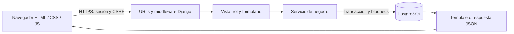

# Arquitectura, seguridad y decisiones

## Recorrido de una operación

Monolito modular: reduce complejidad de despliegue y facilita que los cinco integrantes expliquen cada recorrido. Templates Django son una opción explícita del PDF. CSS propio sin CDN evita depender de redes de terceros durante la exposición. Fetch se usa donde aporta valor: búsqueda de recepción. La API es una consulta JSON autenticada, no una API REST completa de todas las entidades.

## Controles implementados

- Sesiones Django; hash de contraseña; mínimo 10 caracteres y validadores estándar.
- Roles por grupos `Administración` y `Recepción`; comprobación en servidor para cada vista operativa.
- CSRF en formularios, cierre por POST, ninguna eliminación mediante GET.
- ORM, consultas parametrizadas, escape de templates y `textContent` en resultados Fetch.
- Tokens UUID únicos contra reenvío de cobros; montos Decimal y validación de saldo bajo bloqueo.
- Transacciones para cobro, inscripción, asistencia, anulación, cancelación y cambios auditados.
- Bloqueo del socio para inscribir/registrar entrada; bloqueo de membresía para pagos/anulación.
- Restricciones DB sobre fechas/montos, códigos únicos y una asistencia por socio/día.
- Cinco fallos por identificador normalizado en 15 minutos; ventana persistida en DB. Es mitigación básica por cuenta, no protección completa contra ataques distribuidos. Puede causar bloqueo temporal a una cuenta atacada.
- Cabeceras CSP para interfaz propia, DENY contra framing, no-sniff, referrer same-origin y desactivación de cámara/micrófono/geolocalización.
- Respuestas autenticadas `Cache-Control: no-store, private`.
- HTTPS, cookies seguras y HSTS cuando `DEBUG=False`; proxy confiable activable explícitamente.
- No se permiten SQLite ni claves de ejemplo en producción.
- CSV con escape de prefijos de fórmula.
- Auditoría de operaciones funcionales; no se afirma inmutabilidad criptográfica frente al administrador de DB.

## Matriz de permisos

| Acción | Recepción | Administración |
|---|---|---|
| Panel, socios, búsqueda, ficha | Sí | Sí |
| Alta / edición / desactivación de socio | Sí | Sí |
| Eliminar socio sin historial | No | Sí |
| Consultar planes | Sí | Sí |
| Modificar / eliminar plan sin contratos | No | Sí |
| Crear / renovar membresía | Sí | Sí |
| Registrar pago / ver comprobante | Sí | Sí |
| Anular pago / cancelar membresía | No | Sí |
| Registrar asistencia / Fetch | Sí | Sí |
| Reportes / CSV / auditoría / usuarios | No | Sí |
| Cambiar contraseña propia | Sí | Sí |

Recepción puede ver los ingresos agregados del panel y el listado de pagos por necesidad operativa de esta propuesta. Confirmarlo con el negocio; si requiere mayor reserva, modificar esta decisión y sus tests.

## Operación y privacidad

Solicitar autorización antes de cargar datos reales. No registrar lesiones, biometría, tarjeta completa, DPI o diagnósticos. Correo y teléfono son opcionales. Las entrevistas con datos personales quedan fuera del repositorio. Definir retención y eliminación con el responsable. Proteger los backups como la base original. Revisar obligaciones aplicables con el negocio; este proyecto no implementa cumplimiento fiscal automático.

## Límites actuales

No incluye MFA, recuperación de contraseña por correo, detección de fraude, auditoría de lectura de datos, sistema contable, API pública con tokens, alta disponibilidad ni evaluación de penetración externa. Recuperación de cuenta mediante administrador y comando `changepassword`. La protección por cuenta de login puede complementarse con límites del proveedor/proxy. El administrador de Django mantiene usuarios; sus acciones de mantenimiento están en el log del admin, no todas en la auditoría operativa.

## Decisiones y alternativas

- Django 5.2: autenticación, ORM, forms, migraciones y tests integrados, rama LTS.
- PostgreSQL en producción: persistencia y bloqueos de filas verificables. SQLite solo simplifica arranque local.
- WhiteNoise + Gunicorn: servir estáticos versionados y WSGI sin un segundo frontend.
- Reportes operativos por estado actual: al anular hoy un cobro antiguo, el total del período original cambia; no representa contabilidad por fecha de reversión.
- Precio y fechas congelados: cambios de catálogo no alteran acuerdos existentes.
- Anulaciones y bajas lógicas: conservación del historial frente a borrado indiscriminado.

Referencias oficiales consultadas: [Django deployment checklist](https://docs.djangoproject.com/en/5.2/howto/deployment/checklist/), [Render Django](https://render.com/docs/deploy-django), [Render deploys](https://render.com/docs/deploys). Verificar vigencia antes de desplegar.
