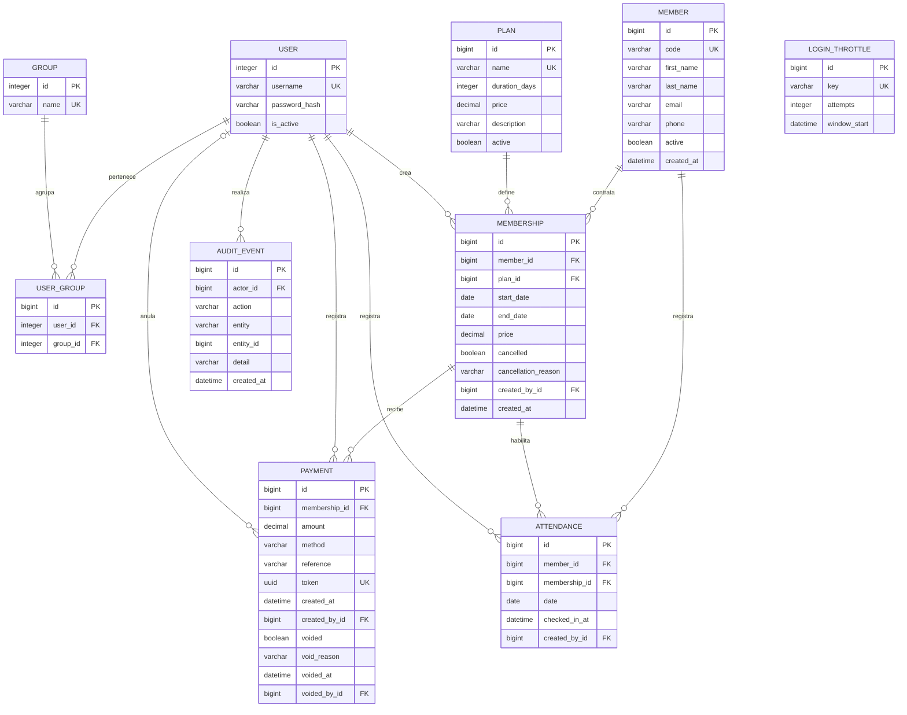

# Modelo relacional · Diagrama Entidad-Relación

El diagrama usa nombres conceptuales. Tablas físicas principales: `gym_member`, `gym_plan`, `gym_membership`, `gym_payment`, `gym_attendance`, `gym_auditevent`, `gym_loginthrottle`. `USER`, `GROUP`, `USER_GROUP` corresponden a `auth_user`, `auth_group` y `auth_user_groups`; Django incluye además permisos, sesiones y migraciones. El campo físico de contraseña se llama `password` y contiene el hash, nunca la contraseña en texto.

## Diccionario y decisiones

| Entidad | Finalidad / campos relevantes | Integridad |
|---|---|---|
| Socio | Código de recepción, nombre, contacto opcional, estado | Código único; datos mínimos; desactivación conserva historial |
| Plan | Nombre, días, precio decimal, descripción | Precio > 0; 1–366 días; nombre único |
| Membresía | Contrato fechado de un socio con un plan | FK protegidas; fin ≥ inicio; precio > 0; no superposición desde servicios |
| Pago | Movimiento asociado a un contrato | Monto > 0; token único; medio en catálogo; anulaciones conservadas |
| Asistencia | Entrada de un socio habilitada por contrato | UNIQUE(socio, fecha); relación socio/membresía comprobada por servicio |
| Auditoría | Autor, acción, tipo e ID de entidad | No usa FK genérica al objeto para conservar eventos de eliminaciones permitidas |
| Intento de acceso | HMAC del usuario, contador y ventana | No guarda la contraseña ni el nombre en texto; clave única |

Montos `Decimal(10,2)`, no flotantes. El precio de la membresía es una copia deliberada del precio aceptado. La fecha de fin también queda congelada al contratar. El saldo se calcula como precio menos pagos no anulados; no se mantiene un segundo saldo susceptible de desincronizarse.

## Cardinalidades y conservación

Un socio tiene muchas membresías; una membresía un solo plan y varios pagos/asistencias. Cada pago tiene un creador y puede tener un anulador. FK operativas usan `PROTECT`: nunca eliminar historial en cascada. La eliminación física se ofrece solo para socios/planes sin relaciones. Usuarios se desactivan.

El servicio de asistencia siempre selecciona la membresía del mismo socio; no permite inyectar una relación ajena mediante formulario. Las garantías entre varias filas (saldo y superposición) requieren los servicios y PostgreSQL. SQL directo o scripts que eludan los servicios quedan fuera de esas garantías.

## Migraciones

`gym/migrations/0001_initial.py` crea el esquema y las restricciones. Ejecutar `python manage.py migrate`. No editar una migración aplicada en producción; crear una nueva y revisar el cambio con el equipo.
